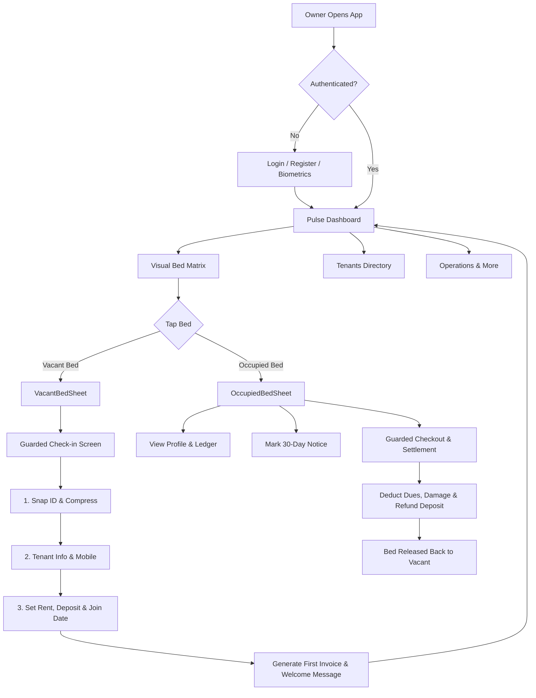

# PG Owner Mobile — Complete Design & Screen Specification

> **Platform**: React Native / Expo Router v4  
> **Styling**: NativeWind v4 (Tailwind CSS)  
> **Backend Integration**: Node.js Express + MongoDB (Mongoose) + Atomic Transactions  
> **State Management**: TanStack React Query + Offline Caching + Biometric Keyring  

---

## 1. Visual Design System & Tokens

### Primary Color Tokens
* **Brand Primary (`#0A6C50`)**: Deep Emerald Green. Used for primary call-to-actions, successful collections, active beds, and brand accents.
* **Hero Surface (`#0F172A`)**: Dark Slate / Deep Navy. Used for the pulse header card on the Dashboard.
* **Danger / Rent Due (`#BE123C` / `#DC2626`)**: Rose / Crimson. Used for occupied bed borders, overdue alerts, and destructive confirmation modals.
* **Warning / Notice (`#D97706` / `#B45309`)**: Warm Amber. Used for notice period beds, upcoming dues, and downgrade warnings.
* **Neutral Slate (`#F8FAFC` to `#0F172A`)**: High-contrast typography and subtle 1px border dividers (`border-slate-200/80`).

### Bed Matrix Color Hierarchy
| Status | Tile Background | Border Color | Text Color | Display Information |
| :--- | :--- | :--- | :--- | :--- |
| **Vacant** | `#F0FDF4` (Emerald 50) | `#86EFAC` (Emerald 300) | `#0A6C50` | Bed number, "Vacant", specific bed price (e.g. `₹8,500`) |
| **Occupied** | `#FFF1F2` (Rose 50) | `#FECDD3` (Rose 200) | `#BE123C` | Bed number, initials avatar, tenant name, rent, `DUE`/`PAID` |
| **Notice Period** | `#FFFBEB` (Amber 50) | `#FDE68A` (Amber 200) | `#B45309` | Bed number, initials avatar, tenant name, rent, days left |
| **Maintenance** | `#F8FAFC` (Slate 50) | `#CBD5E1` (Slate 300) | `#64748B` | Bed number, "Maintenance", wrench icon |

---

## 2. Screen-by-Screen Specification

### 1. Authentication Flow
* **Login (`app/(auth)/login.tsx`)**:
  * Phone Number & Password input with 10-digit validation.
  * Direct Biometric authentication button (Face ID / Fingerprint) for saved credentials.
  * "Forgot Password" guided modal.
  * Link to Register account.
* **Register (`app/(auth)/register.tsx`)**:
  * Owner Full Name, PG / Hostels Organization Name.
  * Mobile Phone, Email, and 6+ character secure password.
  * Direct onboarding trial setup (14-day full Pro trial).

### 2. Pulse Dashboard (`app/(tabs)/index.tsx`)
* **Header Bar**:
  * Property switcher dropdown (`PropertySwitcherModal`) for owners managing multiple PGs.
  * Notification bell icon with indicator.
  * Month selector (e.g. `November 2026`) with trial status badge (`✦ 13 days trial left`).
* **Monthly Rent Collection Banner**:
  * Primary metric: `₹18,666.67 of ₹18,666.67` with live completion percentage (`100%`).
  * Smooth emerald progress bar.
  * Subtext: `100% collected · ₹0 pending`.
* **Quick Action 3-Grid**:
  * **Check-in** (Green tile): Navigates directly to tenant onboarding flow.
  * **Dues** (Amber tile): Jumps to pending rent collection ledger.
  * **+ Property** (Blue tile): Opens property creation wizard.
* **Occupancy & Profit Cards**:
  * **Occupancy**: Shows `1 / 31` beds occupied (`3.2% full`) with horizontal indicator bar.
  * **Net Profit**: Shows monthly P&L summary (`Total Rent Collected - Total Expenses`).
* **Bed Inventory Card**:
  * 4 Status Tiles: Vacant (30), Occupied (1), Notice (0), Maintenance (0).
  * Direct buttons for **"Tenants list"** and **"View grid →"**.
* **Rent Status Banner**:
  * Shows on-time collection health: `✓ All rents collected on time · Zero overdue accounts pending`.
* **Floating Action Button (+)**:
  * Speed dial menu to Check-in Tenant, Add Room, Record Payment, or Add Expense.

### 3. Visual Bed Matrix (`app/(tabs)/matrix.tsx`)
* **Floor Filter Tabs**: Filter rooms by `All Floors`, `Floor 1`, `Floor 2`, etc.
* **Room Container Card**:
  * Room number header (e.g. `Room 101`).
  * Amenities tags: `Washroom`, `AC`.
  * Sharing type badge: `2 share`, `3 share`, etc.
  * "Edit Room" button for managing room name, tags, and floor.
* **Per-Bed Pricing Grid**:
  * Every bed tile displays its individual rate.
  * Allows owners to charge different rates in the same room (e.g. Bed 101-A at ₹8,500, Bed 101-B at ₹7,500).
* **Action Sheets**:
  * Tapping a Vacant Bed opens `VacantBedSheet`.
  * Tapping an Occupied Bed opens `OccupiedBedSheet`.
  * Tapping a Maintenance Bed opens `MaintenanceBedSheet`.

### 4. Guarded Check-in Screen (`app/checkin/[bedId].tsx`)
* **Header Card**:
  * Prominently displays: `Room 101 · Bed 101-B` (Line 1) and `Floor 1 · 2 share` (Line 2).
  * 3-Step Progress Pill: `ID ✓ · Tenant ✓ · Money ✓`.
* **Step 1: ID & KYC Proof**:
  * Camera snap or Gallery upload.
  * Built-in image compression ensuring documents stay under 200 KB.
  * DPDP compliance consent checkbox.
* **Step 2: Tenant Profile**:
  * Full Name, 10-digit Phone, Emergency Contact Number.
* **Step 3: Money & Anniversary Cycle**:
  * Monthly Rent (prefilled from that bed's custom rate).
  * Security Deposit (prefilled to ₹1,000).
  * **Joining Date Calendar (`DatePickerModal`)**: Interactive date picker calculating the join-date anniversary billing cycle (e.g. `15 Nov – 14 Dec`).
  * Advance Collection Toggle: `Cash`, `Dynamic UPI QR`, or `Bank Transfer`.
* **Instant Welcome**:
  * Automatically creates the first rent invoice.
  * One-tap WhatsApp welcome message containing bed number, rent amount, and due date.

### 5. Tenant Directory (`app/(tabs)/tenants.tsx`)
* **Search & Filters**:
  * Real-time search across Tenant Name, Mobile, Room, and Bed label.
  * Filter tabs: `All`, `Active`, `Notice Period`, `Checked Out`.
* **Tenant Cards**:
  * Initials Avatar + Full Name + Phone.
  * Bed info chip: `Room 101 · Bed 101-A · 2 share`.
  * Status badge: `PAID` (Emerald) or `₹8,500 DUE` (Rose).
  * Quick actions: Call, WhatsApp rent reminder, View Profile.

### 6. Tenant Profile & Ledger (`app/tenant/[id].tsx`)
* **Hero Card**: Tenant Avatar, Phone, Room & Bed assignment, Balance Due chip.
* **3-Section Tabs**:
  * **Overview**: Personal info, Emergency contact, Move Bed to any available bed, Start/Cancel Notice Period, Delete Tenant.
  * **Payments & Invoices**: List of all historical and active invoices, Record Payment button, Share PDF Receipt.
  * **ID Proof**: Cloudinary-hosted document with secure encrypted zoom viewer.

### 7. Guarded Checkout & Settlement (`app/checkout/[tenantId].tsx`)
* **Financial Settlement Breakdown**:
  * Security Deposit held.
  * Minus Unpaid Rent Dues.
  * Minus Electricity Sub-meter deductions.
  * Minus Room Damage deductions.
  * **Net Refundable Amount** (highlighted in emerald green).
* **Payment Mode**: Select UPI, Cash, or Bank Transfer for refund dispatch.
* **Confirm Settlement (`ConfirmActionModal`)**: Executes atomic settlement, releases bed back to `available`, and marks invoice closed.

### 8. Operations & Settings (`app/(tabs)/more.tsx`)
* **Organization Card**: Owner name, PG name, and subscription tier (`PRO PLAN`).
* **Operations Hub**:
  * **Tenants Directory** (`TenantsDirectoryModal`)
  * **Expenses & P&L Tracker** (`ExpensesModal`)
  * **Electricity Sub-Meters** (`SubMeterModal`)
  * **Staff Management** (`StaffManagementModal`)
  * **Properties & Rooms Management** (`PropertiesRoomsModal`)
  * **DPDP Statutory Compliance** (`DpdpKycComplianceModal`)
  * **Subscription & Quota Upgrade** (`SubscriptionModal`)
  * **Biometric Lock Toggle** (Face ID / Fingerprint PIN)
  * **Sign Out** (with modern `ConfirmActionModal`)

---

## 3. Universal Modal Suite

| Modal Component | Purpose | Semantic Variant |
| :--- | :--- | :--- |
| `EditBedModal.tsx` | Edit bed label, maintenance note, and custom monthly rent | Primary / Emerald |
| `AddBedModal.tsx` | Add new bed to room with custom monthly rate | Primary / Emerald |
| `VacantBedSheet.tsx` | Vacant bed actions (Check-in, Maintenance, Delete Bed) | Bottom Sheet |
| `OccupiedBedSheet.tsx` | Occupied bed actions (WhatsApp, Profile, Notice, Checkout) | Bottom Sheet |
| `MaintenanceBedSheet.tsx` | Maintenance notes and restore bed to available | Bottom Sheet |
| `DatePickerModal.tsx` | Interactive monthly calendar for joining date selection | Primary / Emerald |
| `DynamicUpiQrModal.tsx` | Zero-setup dynamic UPI QR code generator for payments | Primary / Emerald |
| `IdDocumentViewerModal.tsx` | Secure pinch-to-zoom Aadhaar / Govt ID viewer | Dark / Media |
| `ConfirmDeleteModal.tsx` | Universal destructive dialog (Bed, Room, Floor, Expense, Staff) | Danger (`#BE123C`) |
| `ConfirmActionModal.tsx` | Notice period activation/cancellation and sign out | Warning (`#D97706`) |
| `RecordPaymentModal.tsx` | Record partial or full rent payment with transaction ID | Primary / Emerald |
| `ExpensesModal.tsx` | Add & manage expenses, view monthly P&L | Operations Hub |
| `SubMeterModal.tsx` | Record electricity readings and auto-split room dues | Operations Hub |
| `StaffManagementModal.tsx` | Add and manage managers with scoped permissions | Operations Hub |

---

## 4. End-to-End User Flows

